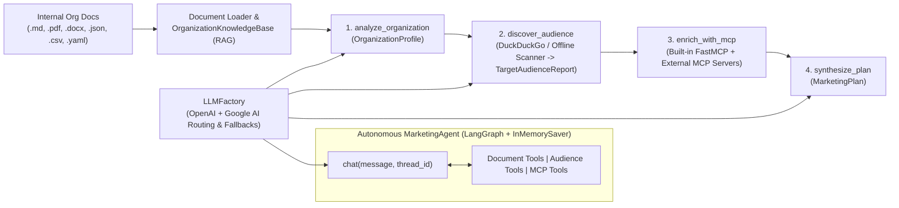

# closr

**Automated Digital Marketing Agent** powered by **LangChain v1.x**, **LangGraph v1.x**, **OpenAI**, **Google AI**, and the **Model Context Protocol (MCP)**.

`closr` ingests an organization's internal documents, builds a persistent RAG knowledge base, discovers and scores target audience segments (ICPs) from external market signals, enriches strategy with real-time MCP marketing tools, and synthesizes end-to-end campaign plans through both a LangGraph pipeline and an interactive tool-calling agent.

---

## Core Capabilities

- **Dual-Provider LLM & Embeddings Architecture (`OpenAI` + `Google AI`)**
  - First-class support for `ChatOpenAI` / `OpenAIEmbeddings` and `ChatGoogleGenerativeAI` / `GoogleGenerativeAIEmbeddings`.
  - Task-based routing via `LLMFactory.get_model_for_task()`: routes `document_analysis` to Google Gemini, `audience_discovery` to your configured default provider, and `strategy` / `agent` orchestration to OpenAI—with automatic cross-provider fallback when only one key is set.
  - Runtime resilience via `RunnableWithFallbacks` (`LLMFactory.get_resilient_chat_model()`).
- **Organization Document Intelligence & Persistent RAG**
  - Multi-format document loaders supporting `.md`, `.txt`, `.pdf`, `.docx`, `.json`, `.csv`, `.yaml`, and `.yml` (single files, directories, or mixed lists).
  - Persistent vector knowledge base (`OrganizationKnowledgeBase` backed by `InMemoryVectorStore` JSON snapshots) and structured `OrganizationProfile` extraction via `OrganizationAnalyzer`.
- **Target Audience Scanning & ICP Discovery**
  - Async market signal collection via `DuckDuckGoWebScanner`, deterministic `OfflineHeuristicScanner`, and `CompositeAudienceScanner` (with automatic offline fallback).
  - `TargetAudienceDiscovery` generates targeted queries, scores and ranks `AudienceSegment` profiles by `fit_score` (0–100), and produces a prioritized `TargetAudienceReport`.
- **MCP Client & Built-in FastMCP Marketing Server**
  - `MCPManager` connects to `stdio`, `streamable_http`, and `sse` MCP servers configured in `mcp_servers.json`, with `${ENV_VAR}` placeholder expansion and per-server failure isolation.
  - Ships with a built-in FastMCP server (`closr.mcp.marketing_server`) exposing 4 marketing intelligence tools:
    - `get_channel_benchmarks` — calibrated CTR, CPC, and conversion benchmarks by vertical (`saas`, `ecommerce`, `fintech`, `healthcare`, `education`, `b2b`, `general`) and channel.
    - `estimate_campaign_budget` — goal-weighted budget allocation and click/conversion/CPA forecasting.
    - `build_utm_tracking_links` — slugified, URL-encoded UTM link builder preserving existing query parameters and A/B `utm_content` variants.
    - `suggest_audience_channels` — prioritized acquisition channels, targeting tactics, community hubs, and regional notes.
- **LangGraph Orchestrator & Rich CLI**
  - Deterministic 4-stage `MarketingPlan` pipeline (`build_marketing_pipeline`) plus a conversational `MarketingAgent.chat()` loop with per-thread `InMemorySaver` memory and automatic profile/audience state synchronization across tool calls.
  - Polished Typer + Rich terminal interface (`closr`).

---

## Architecture Overview



### Module Breakdown

| Module | Responsibility |
| --- | --- |
| `src/closr/config.py` | `ClosrSettings` (`CLOSR_*` env/dotenv config), `LLMProvider`, `MCPServerConfig` |
| `src/closr/llm.py` | `LLMFactory` for provider selection, task routing, embeddings, and `RunnableWithFallbacks` |
| `src/closr/schemas.py` | Pydantic v2 domain models (`OrganizationProfile`, `MarketSignal`, `AudienceSegment`, `TargetAudienceReport`, `CampaignRecommendation`, `MarketingPlan`) |
| `src/closr/documents/` | Multi-format document loader (`loader.py`), persistent RAG store (`vectorstore.py`), `OrganizationAnalyzer` (`analyzer.py`), and LangChain tools (`tools.py`) |
| `src/closr/audience/` | Web & offline heuristic scanners (`scanner.py`), `TargetAudienceDiscovery` (`analyzer.py`), and audience tools (`tools.py`) |
| `src/closr/mcp/` | `MCPManager` (`manager.py`) and built-in FastMCP server (`marketing_server.py`) |
| `src/closr/agent/` | 4-stage LangGraph workflow + `MarketingAgent` (`graph.py`), state (`state.py`), and prompts (`prompts.py`) |
| `src/closr/cli.py` | Typer + Rich CLI (`analyze`, `discover`, `campaign`, `chat`, `mcp-tools`) |

---

## Prerequisites & Installation

- **Python:** `>= 3.14`
- **Package Manager:** [`uv`](https://docs.astral.sh/uv/)

Clone the repository and install dependencies into a managed virtual environment:

```bash
uv sync
```

Verify the CLI is installed:

```bash
uv run closr --help
```

---

## Configuration

### 1. Environment Variables (`.env`)

Copy `.env.example` to `.env` and configure at least one LLM provider API key (configuring both unlocks task-based routing and automatic runtime fallback):

```bash
cp .env.example .env
```

| Variable | Default | Description |
| --- | --- | --- |
| `OPENAI_API_KEY` | — | OpenAI API key (`CLOSR_OPENAI_API_KEY` also accepted) |
| `GOOGLE_API_KEY` | — | Google Gemini API key (`CLOSR_GOOGLE_API_KEY` also accepted) |
| `CLOSR_DEFAULT_PROVIDER` | `openai` | Default LLM provider (`openai` or `google`) |
| `CLOSR_FALLBACK_PROVIDER` | `google` | Fallback provider when primary is unavailable (`openai`, `google`, or empty) |
| `CLOSR_OPENAI_CHAT_MODEL` | `gpt-4o-mini` | OpenAI chat model |
| `CLOSR_OPENAI_EMBEDDING_MODEL` | `text-embedding-3-small` | OpenAI embeddings model |
| `CLOSR_GOOGLE_CHAT_MODEL` | `gemini-2.5-flash` | Google Gemini chat model |
| `CLOSR_GOOGLE_EMBEDDING_MODEL` | `models/text-embedding-004` | Google embeddings model |
| `CLOSR_EMBEDDING_PROVIDER` | — | Optional explicit embeddings provider override (`openai` or `google`) |
| `CLOSR_TEMPERATURE` | `0.2` | Default sampling temperature (`0.0`–`2.0`) |
| `CLOSR_MCP_CONFIG_PATH` | `mcp_servers.json` | Path to external MCP servers configuration file |
| `CLOSR_VECTORSTORE_DIR` | `.closr_data/vectorstore` | Directory for persisted vector knowledge base files |

#### Task-Based Provider Routing

When both keys are configured, `LLMFactory.get_model_for_task()` selects the best-suited provider automatically:
- `document_analysis` -> `google` (long-context document synthesis)
- `audience_discovery` -> `CLOSR_DEFAULT_PROVIDER`
- `strategy` / `agent` -> `openai` (structured strategy & multi-tool calling)

If only one provider key is present, all tasks transparently fall back to the available provider.

### 2. MCP Servers (`mcp_servers.json`)

Copy `mcp_servers.example.json` to `mcp_servers.json` if you want to connect external MCP servers alongside the built-in `closr-marketing` server:

```bash
cp mcp_servers.example.json mcp_servers.json
```

`MCPManager` automatically expands `${ENV_VAR}` placeholders in `url`, `headers`, `env`, and `args`, and supports `stdio`, `streamable_http`, and `sse` transports. Set `"enabled": true` on any server block you wish to activate. Even without a `mcp_servers.json` file, `MarketingAgent` and `closr mcp-tools` automatically include the built-in `closr-marketing` FastMCP server unless disabled (`--no-mcp` / `--no-builtin`).

---

## CLI Usage Guide

The repository includes sample B2B SaaS organization documents under `examples/sample_org_docs/` (`company_overview.md`, `marketing_brief.md`, `product_catalog.json`).

### Inspect Configured MCP Tools

Works out of the box with zero API keys:

```bash
uv run closr mcp-tools
# Or inspect a specific config / exclude the built-in server:
uv run closr mcp-tools --config mcp_servers.example.json
uv run closr mcp-tools --no-builtin
```

### Analyze Organization Documents

Extract a structured `OrganizationProfile` and index documents into the vector store:

```bash
uv run closr analyze examples/sample_org_docs \
  --provider google \
  --output out/profile.json
```

### Discover Target Audiences

Analyze documents, scan market signals, and rank ICP segments:

```bash
uv run closr discover examples/sample_org_docs \
  --focus "EMEA B2B SaaS RevOps" \
  --offline \
  --output out/audience.json
```

*(Omit `--offline` to run live DuckDuckGo web scanning with automatic offline fallback.)*

### Run the Full Marketing Campaign Pipeline

Execute all 4 LangGraph stages (`analyze` -> `discover` -> `MCP enrichment` -> `MarketingPlan`):

```bash
uv run closr campaign examples/sample_org_docs \
  --focus "EMEA Expansion" \
  --budget 25000 \
  --provider openai \
  --output out/marketing_plan.json
```

Optional flags: `--offline` (disable live web search), `--no-mcp` (disable built-in and external MCP servers).

### Interactive Autonomous Chat

Launch a multi-turn strategy session with full tool calling (`analyze_organization_documents`, `search_organization_knowledge`, `scan_market_signals`, `discover_target_audiences`, `evaluate_audience_segment`, and connected MCP tools):

```bash
uv run closr chat \
  --docs examples/sample_org_docs \
  --thread-id q2-growth
```

---

## Python API Usage

```python
import asyncio
from closr import MarketingAgent

async def main() -> None:
    agent = MarketingAgent(include_builtin_mcp=True)

    # 1. Run the full 4-stage LangGraph pipeline
    plan = await agent.run_full_campaign_pipeline(
        docs_path="examples/sample_org_docs",
        focus_area="EMEA SaaS RevOps",
        monthly_budget_usd=25_000.0,
    )
    print("Primary segment:", plan.audience_report.recommended_primary_segment)
    for campaign in plan.campaigns:
        print(f"- {campaign.campaign_name} -> {campaign.channels}")

    # 2. Continue in conversational mode with thread memory
    reply = await agent.chat(
        "Generate UTM tracking links for our primary LinkedIn and Google Search campaigns "
        "pointing to https://novaflow.io/demo.",
        thread_id="strategy-session-1",
    )
    print(reply)

asyncio.run(main())
```

---

## Running Tests

All unit and end-to-end integration tests run completely offline using deterministic fakes and the real built-in FastMCP server over stdio:

```bash
uv run pytest -v
```
